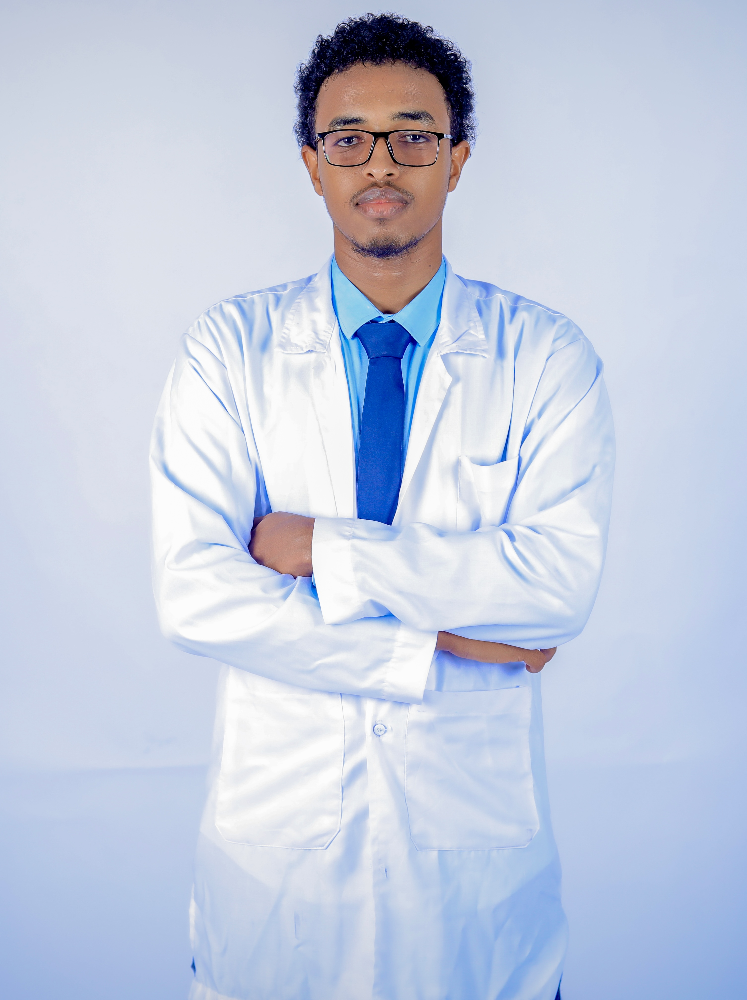
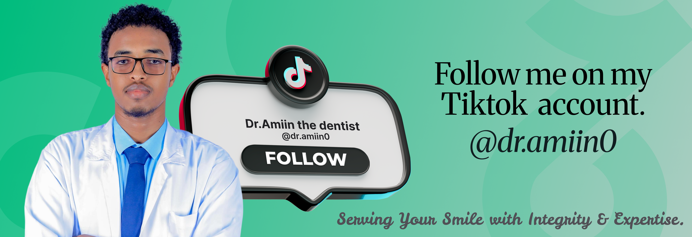

# Dr.Amin Abdi Ismail

I'm Dr. Amin Abdi Ismail, a newly qualified general dentist committed to delivering high-quality, evidence-based care. I'm continually learning, refining my clinical skills, and building a strong foundation in everyday dentistry.

Dedicated and compassionate general dentist seeking a position in a reputable dental practice where I
can apply my clinical skills, commitment to patient care, and continuous learning to provide high-
quality dental services. Eager to contribute to a collaborative team environment while further
enhancing my expertise in comprehensive oral healthcar.

# EDUCATION BACKGROUND

**University**

_Sept 2019 - Sept 2024: Amoud University, Borama Somaliland_

Degree in Bachelor of Dental surgery, courses taken include Operative Dentistry, Orthodontics, Oral
Surgery, Endodontics, prosthodontics, pedodontics.

**Secondary School**

_Sept 2015 - Jul 2019: Al-Aqsa Secondary School_

Obtained a mean grade B (normal) in the Somaliland Certificate of Secondary Education-SCSE
examination.

**Primary School**

_2008 – 2013: SH. Hussein Abraar Primary School, Boorama_

Achieved grade A on Somaliland Certificate of Primary Education Examinations.

# WORK EXPERIENCE & SKILLS

**2020 – 2021: Amoud Dental lab, Borama, Awdal**

- Assisted in patient examinations, diagnosis, and treatment planning.
- Performed basic dental procedures under the supervision of licensed dentists.
- Gained experience in managing dental hygiene, patient education, and preventive care.

**2022 – 2023: Amoud community health clinic, Borama/Awdal**

- Provided assistance during dental procedures and helped maintain a sterile environment.
- Educated patients on oral hygiene and post-treatment care
- Participated in community outreach programs to promote dental health awareness.

**Jan 2024 – May 2024: General Dentist, Qardho**

- Oral Surgery — tooth extractions.
- Restorative Dentistry — direct and indirect restorations.
- Prosthodontics — fixed (crowns, bridges) and removable prostheses.
- Endodontics — root canal treatments.
- Orthodontics — treatment of a variety of cases.

**Sep 2025 – 2026 : Gorowe**

- Oral Surgery — tooth extractions
- Restorative Dentistry — direct and indirect restorations
- Prosthodontics — fixed (crowns, bridges) and removable prostheses
- Endodontics — root canal treatments and re-treatments
- Orthodontics — treatment of a variety of cases.

# SKILLS

- Strong communication and interpersonal skills.
- Understanding of patient management and treatment planning.
- Knowledgeable in operative and Endodontics.
- Strong and foundational knowledge in orthodontics.
- Efficient in crowns and bridges.

## SOCIAL MEDIA

Don't forget I say hi,you know what I mean hit the follow button.

